<div align="center">
  

  <p><code>Hands-on projects from the IBM Full-Stack JavaScript Developer Professional Certificate on Coursera.</code></p>

  <p>
    <a href="https://github.com/Saji-d/ibm-fullstack-javascript-learning-journey"></a>
    
    <a href="https://github.com/Saji-d/ledgerturf"></a>
  </p>
  <p>
    
    
    
    
    
    
  </p>

  <p>
    <a href="#-overview">Overview</a> ·
    <a href="#-highlights">Highlights</a> ·
    <a href="#-the-projects">The Projects</a> ·
    <a href="#-what-is-inside">What is Inside</a> ·
    <a href="#-tech-stack">Tech Stack</a> ·
    <a href="#-how-to-run">How to Run</a> ·
    <a href="#-author">Author</a>
  </p>
</div>


## ◈ Overview

This repository holds the major hands-on projects I completed while pursuing the **IBM Full-Stack JavaScript Developer Professional Certificate** on Coursera.

It is a **learning repository, not a product**. One project covers the front end (a React shopping cart) and the other covers the back end (an Express REST API). The final capstone of the course has its own repository: [LedgerTurf](https://github.com/Saji-d/ledgerturf).


## ◈ Highlights

<table>
  <tr>
    <td width="33%" valign="top"><b>React components</b><br>A plant shop split into landing, product list, cart and about views.</td>
    <td width="33%" valign="top"><b>Redux Toolkit state</b><br>A cart slice with add, remove, increase and decrease actions.</td>
    <td width="33%" valign="top"><b>REST API design</b><br>Public routes to browse books and protected routes to manage reviews.</td>
  </tr>
  <tr>
    <td valign="top"><b>Auth with JWT and sessions</b><br>Login issues a token and middleware guards the <code>/customer/auth</code> routes.</td>
    <td valign="top"><b>Search by ISBN, author and title</b><br>Each lookup has a plain route and an async route that calls the API with Axios.</td>
    <td valign="top"><b>Vite tooling</b><br>Fast dev server, build and ESLint setup for the React app.</td>
  </tr>
</table>


## ◈ The Projects

### Paradise Nursery Shopping Application

A React e-commerce front end for browsing and buying plants. Plants are grouped into categories such as Air Purifying, Aromatic Fragrant, Insect Repellent, Medicinal and Low Maintenance. The cart supports adding items, changing quantities and live totals, and state lives in Redux Toolkit.

### Express Book Reviews API

A RESTful back end built with Node.js and Express where users browse books and manage their own reviews.

| Method | Route | Access | Purpose |
|--------|-------|--------|---------|
| GET | `/` | Public | List all books |
| GET | `/isbn/:isbn` | Public | Find a book by ISBN |
| GET | `/author/:author` | Public | Find books by author |
| GET | `/title/:title` | Public | Find books by title |
| GET | `/review/:isbn` | Public | Read the reviews of a book |
| GET | `/asyncbooks` and the other `/async...` routes | Public | Same lookups through Axios with async and await |
| POST | `/customer/login` | Public | Log in and receive a JWT |
| PUT | `/customer/auth/review/:isbn` | Logged in | Add or modify your review |
| DELETE | `/customer/auth/review/:isbn` | Logged in | Delete your review |


## ◈ What is Inside

```text
ibm-fullstack-javascript-learning-journey/
├── frontend-project/
│   └── e-plantShopping/            React + Vite app (src/ has ProductList, CartItem, CartSlice, store)
└── backend-project/
    └── expressBookReviews/
        └── final_project/          Express server (index.js, router/general.js, auth_users.js, booksdb.js)
```


## ◈ Tech Stack

| Layer | Technologies | Purpose |
|-------|--------------|---------|
| Front end | React 18, Redux Toolkit, React Router, Vite | Plant shop UI, cart state and tooling |
| Back end | Node.js, Express, express-session, jsonwebtoken | REST API and authorization |
| HTTP client | Axios | Async routes that call the API |
| Quality | ESLint, nodemon | Linting and auto-restart in development |


## ◈ How to Run

Both projects need Node.js and npm.

```bash
# Front end: Paradise Nursery
cd frontend-project/e-plantShopping
npm install
npm run dev

# Back end: Express Book Reviews (listens on port 5000)
cd backend-project/expressBookReviews/final_project
npm install
npm start
```


## ◈ Author

**Sajidur Rahman Sajid**: Full-Stack Developer and AI engineer from Dhaka.<br>
BSc in CSE at American International University-Bangladesh (AIUB).

<p>
  <a href="https://www.sajidur.me"></a>
  <a href="https://www.linkedin.com/in/sajidur-rahman-sajid/"></a>
  <a href="https://github.com/Saji-d"></a>
  <a href="mailto:sajidsajidurrahman99@gmail.com"></a>
</p>

<sub>IBM Full-Stack JavaScript Developer Professional Certificate, Coursera.</sub>
